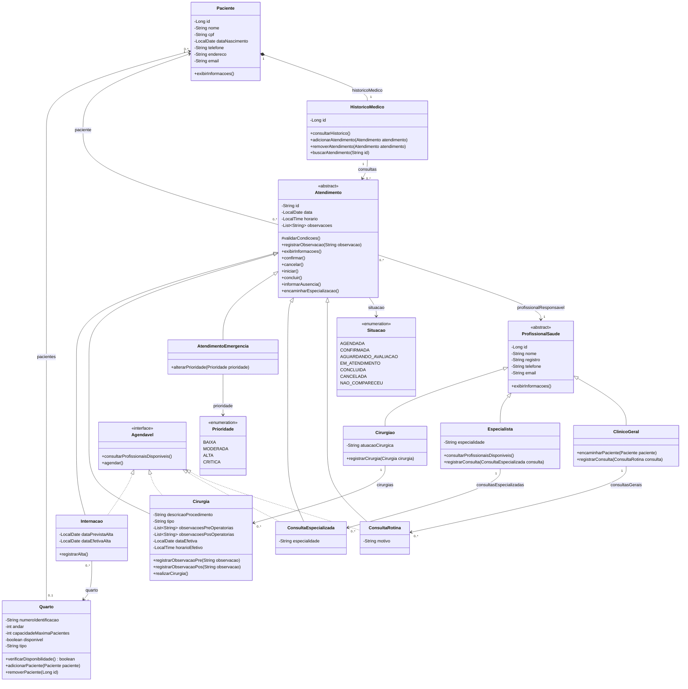

# Diagrama de classes da Sprint 2

Representação do domínio implementado a partir do [UML fornecido](Diagrama%20de%20Classes%20-%20Sprint%202.png). A assinatura que menciona `ConsultaGeral` usa a classe `ConsultaRotina` desenhada no UML. O tipo de quarto continua sendo `String`.

